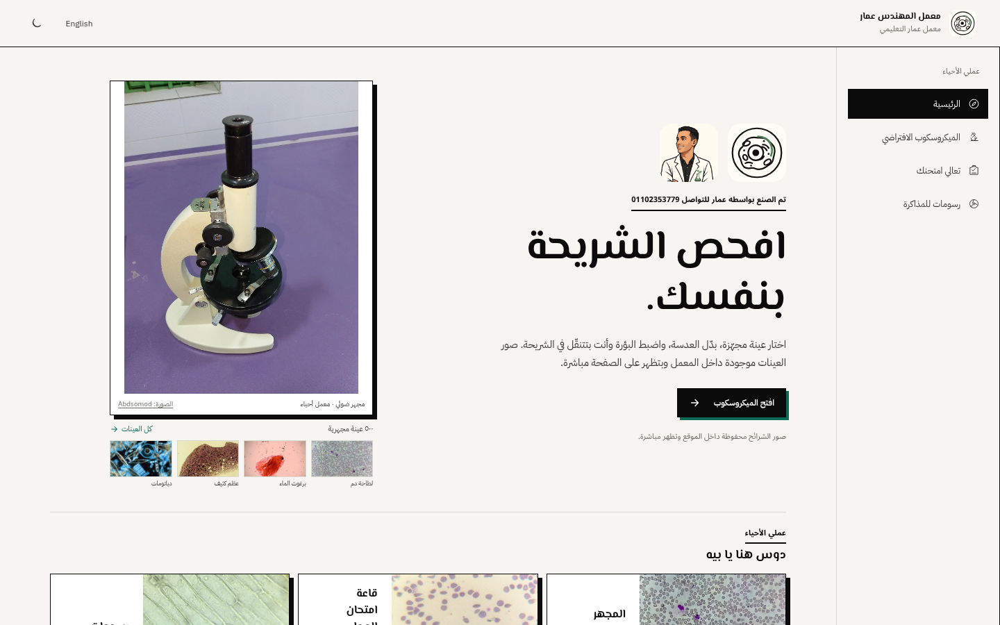
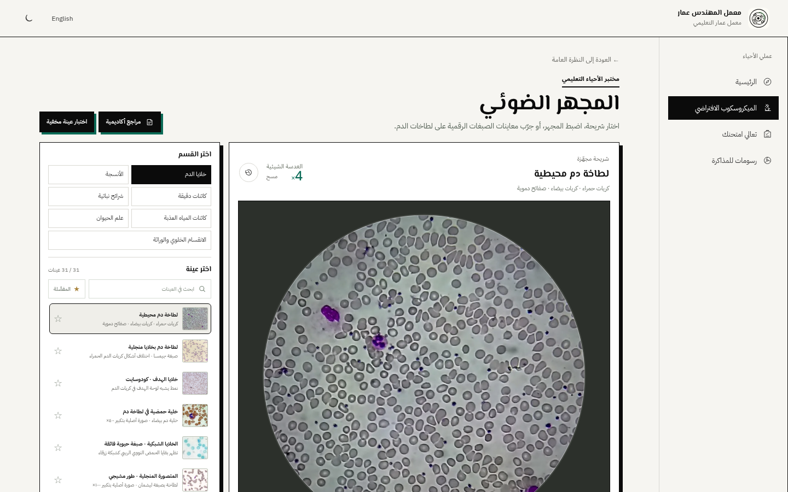

# Faculty of Science Virtual Lab (معمل عمار التعليمي)

A free bilingual (Arabic / English) virtual biology lab for Faculty of Science students: a virtual microscope with **500 licensed specimens**, practical-exam practice, and labelled study diagrams (schemas, **9 so far, more are being added**).

**Live sites:** https://scilab-wheat.vercel.app/ and https://scilab.amarhossam0000.workers.dev

> **Designed and built by Ammar Hossam Alqahran.** The interface, layout, interactions, exam logic and bilingual content structure are my own work. The specimen photographs are **not** mine: they come from Wikimedia Commons and other open sources, credited below.

| Home | Virtual microscope |
| --- | --- |
|  |  |

| Practical exams | Study diagrams |
| --- | --- |
|  |  |

## Features

- **Virtual microscope** with 500 real photomicrographs: histology (126), botany (108), microbiology (99), zoology (88), hematology (31), aquatic life (29) and genetics (19). Search, favorites, objective, focus and light controls, drag to move (the specimen always stays covering the field), pinch-to-zoom on touch screens, a blood-stain bench (digital filters) and a blind identification challenge.
- **Practical exam room:** identify specimens, compare slides, stain-selection questions, preparation workflow and a browser-local lab notebook.
- **Schemas:** 9 labelled diagrams so far (5 slide drawings and 4 plates: heart, animal cell, dicot leaf, lab apparatus) with study and exam modes. More schemas are in progress.
- **Licence credits:** every photo has its author, free licence (CC0, CC BY, CC BY-SA or public domain) and source link in [`docs/specimen-photo-credits.md`](docs/specimen-photo-credits.md) and under the specimen in the app.
- **Request box:** a search box that checks whether a specimen or schema exists, and lets students send a request for a missing one.
- **Design:** new cell logo, SciLab character and loading screen; El Messiri headings and IBM Plex Sans Arabic body text (SIL OFL, self-hosted); light and dark theme; Arabic and English with right-to-left layout.
- **Speed:** specimen photos are WebP, and the share image is a small 1200x630 JPG for link previews.
- **Sharing and SEO:** title, description and Open Graph / Twitter tags; clear titles in the browser tab.
- Client-side only: no accounts, backend or database. Preferences, favorites and notes stay in the browser.

**Built with:** React 19, TypeScript, Vite 7, Tailwind CSS 4, React Router 7, Framer Motion. Deployed on Vercel and Cloudflare Workers (`wrangler.jsonc`).

## Run locally

Requirements: Node.js 22 LTS and pnpm 11.25.0 (the package manager version is pinned in `package.json`).

```sh
corepack pnpm install --frozen-lockfile
corepack pnpm dev
```

Vite serves the app on `http://localhost:3000`. Create an optimized static build with `corepack pnpm run build`; the output is in `dist/`.

## Learning modules

- **Microscope** (`/microscope`): browse 500 photomicrographs across histology, botany, microbiology, zoology, blood cells, aquatic life and genetics. Search the collection, save favorites in this browser, or use a blind identification challenge. The blood collection includes sickle-cell, target-cell, eosinophil, reticulocyte, and malaria films. A blood-stain bench previews Wright-Giemsa, Giemsa, new methylene blue, and brilliant cresyl blue color treatments; these are digital filters, not simulated chemical binding or new scientific evidence. The photos load from the local site bundle and appear directly in the microscope field. Objective, focus, illumination, and drag-to-move controls adjust the view. Zoom is illustrative and is not calibrated; selecting 100× displays a note about immersion oil in real microscopy. Photo credits and licenses are listed in `docs/specimen-photo-credits.md` and the microscope's source dialog.
- **Practical exams** (`/exams`): identify randomized specimens from a microscope field, compare two slides and record observations, answer stain-selection questions, order the general thin-film preparation workflow, and keep/export a browser-local notebook. The schema section links directly to the interactive diagram exams.
- **Scientific schemas** (`/schemas`): 9 labelled diagrams so far, including a heart/circulation plate, generalized leaf section, introductory lab-apparatus plate and typical animal-cell plate, with more being added. Study mode connects interactive SVG pins and the structure index to bilingual names, functions, and exam notes. Exam mode hides labels and accepts either a structure click or a typed Arabic/English name, with immediate feedback.
- **Preferences**: Arabic/English locale and dark/light theme are switchable and stored locally in browser storage.

## Scientific use and limitations

This is an educational viewer, not a live feed from a microscope or a calibrated measurement system. The source photographs come from teaching and research collections; their stain, illumination, framing, and original magnification vary. On-screen objective and focus controls are visual aids. The photographs should not be used for diagnosis.

Each specimen includes an Academic References dialog. Scientific content and source metadata are centralized in `src/data/scientificData.ts` and `src/data/specimenMedia.ts`.

## Credits and sources

**Design and code:** Ammar Hossam Alqahran.

**Specimen photographs.** All 500 photomicrographs and the landing-page microscope photo are third-party images bundled locally. Each one is credited to its author with its license and source link in [`docs/specimen-photo-credits.md`](docs/specimen-photo-credits.md). They come mostly from [Wikimedia Commons](https://commons.wikimedia.org/) under CC0, CC BY, CC BY-SA 3.0 and CC BY-SA 4.0 licenses, including photographs by Microrao, Dr Graham Beards, Prof. Osaro Erhabor, Josef Reischig's archive (shared by his heirs), the Department of Pathology at Calicut Medical College, NOAA and others. The author and license are also shown under each specimen inside the app. Images are downscaled to 1000 px wide and stored as WebP; the credits file notes any other change.

**Scientific content.** Specimen descriptions, diagram labels and exam answers cite academic references listed in [`docs/scientific-sources.md`](docs/scientific-sources.md) and in each Academic References dialog. Research notes are in [`docs/research-notes.md`](docs/research-notes.md).

If you are the author of an image used here and want a credit changed or the image removed, please open an issue.

## Project map

```text
src/app/          Routes and persisted locale/theme preferences
src/components/   App shell, controls, reference dialog, logo mark
src/data/         Bilingual specimen/diagram records and source metadata
src/i18n/         Typed English/Arabic interface strings
src/microscope/   Canvas2D microscope field for bundled slide photographs
src/pages/        Landing, microscope, atlas, and diagram study/exam views
src/schemas/      SVG schema plates and interactive structure pins
public/           Logo, social preview image and bundled specimen photographs
```

## Routes

- `/` overview and learning pathways
- `/microscope` microscope workspace
- `/exams` practical exam room and lab notebook
- `/schemas` schema atlas
- `/schemas/:diagramId` schema study or exam view
